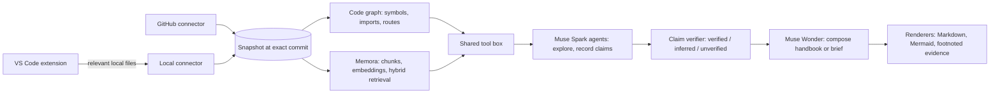

# GitFill

**Understand, explain, reuse and evolve any codebase.**

GitFill turns a repository into things developers can use: evidence-backed answers to code questions with diagrams, handbooks for an entire repository, a module or a feature, architectural commit-to-commit reports, implementation briefs that transfer patterns between repositories, documentation, and validated presentations. Every statement it produces cites the file and lines it comes from, and GitFill's own code checks those citations against the source before anything is shown.

GitFill is a web app (GitHub repositories) and a VS Code extension (local code, including unpushed work) over one shared engine. It is also the first connector of **OneFill**, an AI-first workspace for creating documents in natural language.

## What you can do

| Feature | Where | Output |
| --- | --- | --- |
| **Ask about the code** — "What happens after the user clicks login?", "Why does this service call that repository?" | Chat, VS Code | Markdown answer with `path:line` sources, optional Mermaid diagram (sequence, flowchart, class, ER, component, dependency), list of what could not be verified |
| **Repository handbook** — whole repo, one module, or one feature; as a technical handbook, hackathon pitch guide, new-developer guide or backend/frontend deep dive | Web | Overview, architecture (diagram), directory guide, end-to-end workflows (sequence diagrams), API table, data flow and models (ER), tech stack, design decisions with evidence, presentation guide, Q&A prep, getting started, open questions |
| **Commit-to-commit analysis** — any two commits, branches or tags | Web, VS Code (local refs) | Change summary, before/after structure, measured structural diff (moved/added/removed declarations, module dependencies, packages, routes, directories), impact on dependents, interfaces, tests and risks; hypotheses labelled as such |
| **Architecture reuse** — "make repo B follow repo A's service/repository layering but keep B's models" | Web | Implementation brief: patterns with reference files, target state, comparison table, file-by-file plan, dependencies, constraints, do-not-modify list, acceptance criteria, tests. Exportable as Markdown or JSON for a coding agent |
| **Documentation** | VS Code, Web | Doc comments with a diff preview (Apply/Reject), README drift detection with one-click fixes, README generation |
| **Presentations** | Web | Editable `.pptx` + PDF, rendered, checked and repaired automatically |

## How it works



1. **Snapshot.** The GitHub connector resolves a branch to a commit SHA, reads the most informative files within a fixed budget, and skips secrets, lockfiles, binaries and build output. The VS Code extension builds the same snapshot type from local files (including uncommitted ones). Repository code is never executed.
2. **Deterministic analysis.** Code (not the model) extracts declarations with line ranges, resolves imports into a module graph, detects HTTP routes for common frameworks, and for commit comparisons computes the structural diff between the two versions.
3. **Retrieval with Memora.** When `MEMORA_BASE_URL` and `MEMORA_API_TOKEN` are set, each snapshot is indexed in [Memora](../Memora) as Markdown bundles whose headings carry file paths and whose lines carry line numbers. Questions go through Memora's pipeline (hybrid dense + lexical search → MMR → cross-encoder reranking) and the passages come back mapped to `path:lines`. Agents also get a `retrieve_context` tool. Without Memora, agents use literal search and the code graph.
4. **Agents with real tools.** Muse Spark explores through `read_file`, `search_code`, `outline_file`, `find_symbol`, `find_references`, `call_graph`, `list_routes`, `module_graph` and `retrieve_context`, and records claims with exact file and line ranges. `verifyClaim` checks each one against the real lines and assigns the status; the model never does.
5. **Structured output, then rendering.** Muse Wonder composes handbooks and implementation briefs as Zod-validated JSON that cites claim refs. Diagrams are structured nodes and edges pointing at files; code renders the Mermaid, escapes labels, drops edges to unknown nodes and marks inferred elements with dashed lines. Unknown claim refs are stripped. Markdown footnotes link every statement to GitHub at the analyzed commit.
6. **Two interfaces, one engine.** The web app understands repositories and produces documents; the extension works on local code and applies approved documentation changes.

### Models

| Role | Model | Used for |
| --- | --- | --- |
| analyst, explainer, differ | `muse-spark-1.3` | Tool loops: exploration, questions, commit interpretation |
| architect, planner | `muse-wonder-1.0` | Composing handbooks and briefs; planning decks |
| writer, reviewer, repairer | `muse-spark-1.3` | README, doc comments, drift checks; slide review and repair |
| illustrator | `muse-image-1.0` | Deck artwork |

`MUSE_USE_CONTRIBUTOR=true` routes the loop-heavy roles to `-contributor` models (Meta may train on those inputs; public repos only).

## Setup

Requirements: Node.js 22, a Postgres database (Neon recommended) **or nothing** (embedded PGlite), and for presentations only: LibreOffice and poppler-utils.

```bash
npm install
cp .env.example .env     # the only file you write: set DATABASE_URL and MODEL_API_KEY
npm run db:migrate
npm run dev:all          # web app on :3000 + background worker
```

**Zero-infrastructure run.** Set `DATABASE_URL=pglite:./storage/pglite` in `.env`; jobs then run inside the web process, so `npm run db:migrate && npm run dev` is enough.

Open http://localhost:3000, sign in with the demo account, create a workspace from a public GitHub URL, and ask a question or click **Handbook** on the repository.

### Memora (retrieval)

Run the Memora backend (see `../Memora/README.md`), create an application and a credential in its console, and set `MEMORA_BASE_URL` and `MEMORA_API_TOKEN`. GitFill creates one Memora subject per analyzed commit and reuses it. The Settings page and `/api/health` show whether Memora is reachable.

### VS Code extension

In the web app go to **Settings → VS Code extension** and create a token. Then:

```bash
cd extension && npm install && npm run compile   # F5 in VS Code, or `npm run package` for a .vsix
```

Run **GitFill: Sign in**, paste the server URL and token. See [extension/README.md](extension/README.md).

### Environment variables

| Variable | Required | Purpose |
| --- | --- | --- |
| `DATABASE_URL` | yes | Postgres connection string, or `pglite:<dir>` for an embedded database |
| `MODEL_API_KEY` | yes | Meta Model API key |
| `MODEL_API_BASE_URL` | no | Defaults to `https://api.meta.ai/v1` |
| `MUSE_USE_CONTRIBUTOR` | no | `true` to use contributor-tier models (development only) |
| `MEMORA_BASE_URL`, `MEMORA_API_TOKEN` | no | Memora retrieval service and application credential |
| `MEMORA_INDEX_TIMEOUT_MS` | no | How long jobs wait for a fresh index (default 150000) |
| `GITHUB_TOKEN` | no | Fallback for users without a connected GitHub account: public repos at 5,000 requests/hour |
| `GITHUB_OAUTH_SCOPES` | no | Scopes requested at sign-in (default `read:user user:email repo`) |
| `TOKEN_ENCRYPTION_KEY` | prod | Encrypts users' GitHub tokens at rest (falls back to `AUTH_SECRET`) |
| `INLINE_WORKER` | no | `true` runs jobs inside the web process (automatic for PGlite) |
| `AUTH_MODE` | no | `stub` (default in development) or `github` (default in production) |
| `AUTH_SECRET` | prod | 32+ characters, signs session cookies |
| `GITHUB_OAUTH_CLIENT_ID` / `GITHUB_OAUTH_CLIENT_SECRET` | for GitHub sign-in | OAuth app with callback `<APP_BASE_URL>/api/auth/github/callback` |
| `APP_BASE_URL` | no | Public URL of the app (shown to the extension) |
| `ARTIFACT_STORAGE_PATH` | no | Where generated files are stored (default `./storage`) |
| `SOFFICE_PATH` | no | LibreOffice binary (default `soffice`) |

## Scripts

| Command | What it does |
| --- | --- |
| `npm run dev:all` | Web app and worker together |
| `npm run dev` / `npm run worker` | Web app only / worker only |
| `npm run db:migrate` | Applies `lib/db/migrations` (Postgres or PGlite) |
| `npm run db:generate` | Creates a migration after editing `lib/db/schema.ts` |
| `npm test` | Unit tests (analysis, Mermaid, structural diff, connectors, Memora bundling, rendering) |
| `npm run typecheck` / `npm run lint` | Type and lint checks |
| `npm run muse:check` | Live check of every Muse capability GitFill uses |

## API

Responses use `{ "data": ... }` or `{ "error": { "code", "message" } }`. Browser routes use the session cookie; `/api/ext/*` also accepts `Authorization: Bearer gf_…`.

| Method | Path | Purpose |
| --- | --- | --- |
| `GET`/`POST` | `/api/workspaces` | List or create workspaces (`name`, optional `importUrl`) |
| `GET` | `/api/workspaces/:id` | Repositories, documents, presentations and recent jobs |
| `POST` | `/api/workspaces/:id/repositories` | Import (`{mode:"import",url}`) or create (`{mode:"create",name}`) a repo |
| `GET` | `/api/workspaces/:id/repositories/:repoId/commits?branch=` | Recent commits (for the comparison picker) |
| `GET`/`POST` | `/api/workspaces/:id/chat` | Conversation history / message the agent (it can answer code questions and start any job) |
| `POST` | `/api/workspaces/:id/ask` | Synchronous code question: `repositoryId`, `question`, `diagram`, `save`, `mirrorToChat` |
| `POST` | `/api/workspaces/:id/handbook` | Queue a handbook: `repositoryId`, `audience`, `scope`, `focus`, `instructions` |
| `POST` | `/api/workspaces/:id/compare` | Queue a commit comparison: `repositoryId`, `base`, `head`, `focus` |
| `POST` | `/api/workspaces/:id/reuse` | Queue an implementation brief: `referenceRepositoryId`, `targetRepositoryId`, `request`, `reuseKinds[]` |
| `POST` | `/api/workspaces/:id/generate` | Queue a presentation |
| `GET` | `/api/documents?workspaceId=&kind=` | Documents (handbook, commit_report, implementation_brief, explanation) |
| `GET`/`DELETE` | `/api/documents/:id` | Document with Markdown, structured spec, snapshots and verified claims |
| `GET` | `/api/documents/:id/download?format=md\|json` | Download the Markdown, or the structured spec for tooling |
| `GET` | `/api/jobs/:id` | Job status and every recorded tool and model call |
| `GET`/`POST`, `DELETE` | `/api/tokens`, `/api/tokens/:id` | Personal API tokens for the extension |
| `GET` | `/api/github/repositories?query=` | Repositories the user's connected GitHub account can access |
| `GET` | `/api/auth/github?mode=connect&next=` | Connect (or reconnect) a GitHub account to the signed-in user |
| `POST` | `/api/auth/github/disconnect` | Forget the user's GitHub token |
| `GET` | `/api/ext/me` | Token check and server capabilities |
| `POST` | `/api/ext/explain` | Explain local code: `question`, `workspace{files}`, optional `focus{path,startLine,endLine,selection}` |
| `POST` | `/api/ext/document` | Doc comments for a file or selection, with a full-file preview |
| `POST` | `/api/ext/changes` | Explain a git diff (working tree, staged, or a commit range) with current file contents |
| `POST` | `/api/ext/drift` | README statements a diff makes outdated, with proposed edits |
| `GET`/`POST` | `/api/presentations`, `/api/presentations/:id/*` | Decks, revisions and downloads |
| `GET` | `/api/health` | Database, model, Memora and worker status |

## Evaluating output quality

- **Explanations and handbooks**: every claim is stored with its status. The Evidence tab of a document lists them; a high unverified share means the agent asserted things the cited lines did not support.
- **Diagrams**: rendered only from validated structure; edges to unknown nodes and syntax problems are dropped and recorded as `diagramIssues` in the document metadata.
- **Commit reports**: the "Measured by GitFill" section is computed from both versions; the model's narrative must be consistent with it.
- **Implementation briefs**: constraints, do-not-modify lists and acceptance criteria are explicit so the result of executing a brief can be checked.

## GitHub access model

Every repository read happens **as the signed-in user**. Signing in with GitHub (or connecting GitHub from Settings when using the demo account) stores the user's OAuth token encrypted with AES-256-GCM. GitFill then uses that token, and only that token, for that user's imports, questions, handbooks, comparisons and presentations, so each user gets their own rate limit and access to the private repositories their account can read. Users can disconnect at any time; a revoked token is detected on the next GitHub call and cleared. `GITHUB_TOKEN` is only a server-side fallback for users who have not connected GitHub, and it only reaches public repositories. The Add repository dialog lists the user's own repositories once connected.

## Security notes and limitations

- Users' GitHub tokens are stored encrypted (`TOKEN_ENCRYPTION_KEY`), decrypted only to make that user's own GitHub requests, never logged or returned by any API. GitFill requests read access only and never writes to GitHub. OAuth apps have no read-only private scope, so `repo` is requested; a GitHub App installation would narrow this further and is the natural next step for organizations.
- Repository and workspace contents are treated as untrusted data: prompts say so, all agent tools are read-only, tool arguments are schema-validated, and no shell or SQL is ever built from model output.
- Outbound requests go only to `api.github.com`, `raw.githubusercontent.com`, the configured model API and the configured Memora URL.
- File reads, bytes, tool calls, agent turns and claims are capped; every failure is recorded in the job's activity.
- Repository content is never stored in GitFill's database (only metadata, claims and generated documents). When Memora is configured, bundled file contents are stored there under your Memora application.
- API tokens for the extension are stored hashed (SHA-256) and can be revoked at any time.

See [docs/architecture.md](docs/architecture.md) for the design.

## License

Apache-2.0
