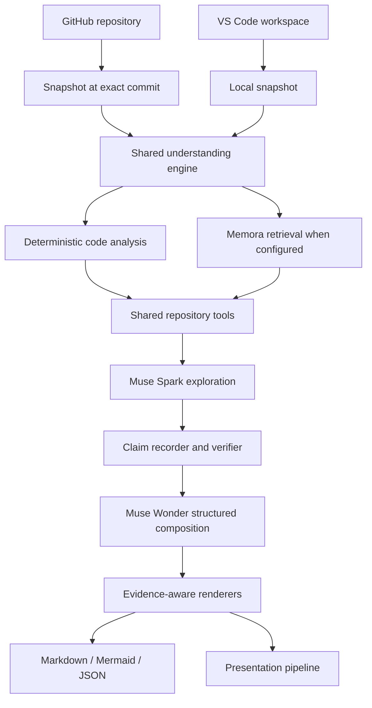

# GitFill — Product & Technical Demonstration Handbook

> **Purpose:** A practical guide for presenting GitFill, explaining how it works, and demonstrating its capabilities to developers, engineering leads, hackathon judges, and potential users.
>
> **Repository:** [Gopinathv19/GitFill](https://github.com/Gopinathv19/GitFill)  
> **Default branch:** `main`  
> **License:** Apache-2.0

---

## 1. What is GitFill?

GitFill helps developers understand, explain, document, compare, and reuse software architectures. It turns a repository or local workspace into evidence-backed engineering outputs instead of treating source code as an opaque collection of files.

GitFill has two interfaces powered by one shared understanding engine:

- **Web application:** analyzes GitHub repositories and produces explanations, handbooks, commit reports, implementation briefs, documents, and presentations.
- **VS Code extension:** works with local source code, including unpushed changes, and brings explanations, diagrams, documentation previews, and change analysis into the editor.

The central product idea is: **make a codebase understandable and actionable, with evidence attached to what the system says.**

### Who benefits?

| Audience | Useful outcome |
| --- | --- |
| New developers | Learn the architecture, directory structure, APIs, and important workflows of an unfamiliar codebase |
| Maintainers | Understand change impact, dependencies, risks, and stale documentation |
| Engineering leads | Review architectural evolution and communicate design decisions |
| Teams modernizing systems | Transfer proven patterns from one repository to another through a constrained implementation brief |
| Hackathon teams | Prepare a product narrative, technical walkthrough, demo path, and judge Q&A |

---

## 2. Capability map

| Capability | Input | Output | Main interface |
| --- | --- | --- | --- |
| Code Q&A | Repository and a natural-language question | Explanation, file/line references, optional diagram, unverified items | Web, VS Code |
| Repository handbook | Whole repo, module, or feature; audience and instructions | Structured handbook with architecture, workflows, APIs, data flow, diagrams, onboarding, and evidence | Web |
| Commit comparison | Two commits, branches, or tags | Before/after analysis, measured structural changes, impact, tests, and risks | Web, VS Code |
| Architecture reuse | Reference repo, target repo, and reuse request | Implementation brief with patterns, target state, file-level plan, constraints, and acceptance criteria | Web |
| Documentation generation | File or code selection | Documentation comments with a diff preview and explicit apply step | VS Code |
| README drift detection | README plus working-tree changes | Statements made outdated by the changes and proposed edits | VS Code |
| Presentation generation | Repository context and presentation request | Editable PPTX and PDF, rendered and checked through a presentation pipeline | Web |
| Job inspection | A generated job | Status and recorded agent/tool/model events | Web/API |

### What makes the output different?

GitFill is designed to distinguish source-supported facts from model interpretation:

- **Verified:** the cited file and line range was checked against the snapshot.
- **Inferred:** a reasonable interpretation, but not a direct fact established by the cited source.
- **Unverified:** the system could not substantiate the claim. It should remain visible as uncertainty rather than being presented as fact.

The renderer links citations to the repository at the exact analyzed commit. This matters because a line reference against a moving branch can become misleading after new commits.

---

## 3. How GitFill works

GitFill is implemented as a modular monolith: a Next.js application provides the web UI and API, a worker handles queued jobs, and both the web application and VS Code extension use shared libraries.



### Step 1 — Build a source snapshot

For a GitHub repository, GitFill resolves the requested branch to a commit SHA and retrieves selected source files. For VS Code, it creates the same snapshot shape from files supplied by the extension, including local and unpushed work.

The snapshot is the boundary for analysis. It gives downstream tools a stable view of the source and avoids silently mixing code from different revisions.

GitFill filters out sensitive or low-value files such as environment files, keys, lockfiles, binaries, generated output, and build directories. Repository code is analyzed as data; it is not executed.

### Step 2 — Compute code structure deterministically

Static analysis extracts information that should not depend on an LLM guessing:

- Declarations and their source line ranges.
- Imports and resolved internal module dependencies.
- Reverse dependency relationships and external package usage.
- HTTP routes for supported framework conventions.
- Symbols, references, and call-graph information.
- Directory summaries and module graphs.
- Structural differences between two source revisions.

The analysis layer includes symbol, import, graph, route, structural-diff, and Mermaid modules under `lib/analysis/`.

### Step 3 — Retrieve relevant context

When Memora is configured, GitFill bundles a snapshot into Markdown sources. Each file is represented with a path heading and numbered source lines. This allows retrieved chunks to map back to file paths and line ranges.

The documented retrieval flow is hybrid dense and lexical search, followed by MMR and cross-encoder reranking. If Memora is unavailable or not configured, GitFill falls back to literal search and the computed code graph.

Memora is an optional retrieval accelerator and context source. It is not the final authority for citations: GitFill still checks evidence against the actual snapshot.

### Step 4 — Explore with tools

The agent does not need to receive the entire repository as an unstructured prompt. It can explore through bounded repository tools, including:

- `read_file`
- `search_code`
- `outline_file`
- `find_symbol`
- `find_references`
- `call_graph`
- `list_routes`
- `module_graph`
- `retrieve_context`
- `record_claims`

This lets the analyst follow a feature through routes, services, data access, and supporting modules. Tool calls and model calls are recorded as job events.

### Step 5 — Verify claims

The model proposes claims with file paths and line ranges. GitFill's evidence layer checks the references against source lines and assigns a status. Unknown references are removed from structured output rather than being allowed to become plausible-looking citations.

### Step 6 — Compose and render

The system uses structured, Zod-validated output schemas for handbooks, explanations, commit reports, and implementation briefs. Markdown and diagrams are rendered by application code.

Diagrams are represented as structured nodes and edges, validated, and then rendered as Mermaid. Labels are escaped, dangling edges are removed, and inferred diagram elements are visually distinguished.

---

## 4. Capability walkthroughs

### 4.1 Ask questions about a codebase

**What to demonstrate**

Ask a question that requires tracing a real behavior across multiple files. Examples:

- “What happens after a user signs in with GitHub?”
- “How does the application decide which files to include in a repository snapshot?”
- “Trace a handbook-generation request from the API route to the final Markdown document.”
- “Where is evidence verified, and what happens when a claim cites an unknown reference?”

**What the audience should see**

1. A natural-language question.
2. The agent exploring relevant code with tools.
3. A direct explanation with file and line references.
4. An optional Mermaid diagram for a flow or relationship question.
5. Explicit unverified items or follow-up questions where evidence is incomplete.

**Why this matters:** this is more useful than a generic chatbot answer because the explanation is tied to a particular source snapshot and citations are checked by the application.

### 4.2 Generate a repository handbook

A handbook can cover a whole repository, a module, or a feature. The audience can be selected to change the document's emphasis:

- Technical handbook.
- Hackathon pitch guide.
- New-developer onboarding guide.
- Backend deep dive.
- Frontend deep dive.

The handbook pipeline has two main stages:

1. **Explore:** Muse Spark investigates the source through repository tools and records claims and exploration notes.
2. **Compose:** Muse Wonder turns the evidence and computed repository facts into a structured handbook specification.

The renderer can include:

- Project overview and problem statement.
- Architecture narrative and layer table.
- Architecture and dependency diagrams.
- Directory guide and recommended starting files.
- End-to-end workflows and sequence diagrams.
- API route table.
- Data flow, data models, and ER diagram.
- Technology stack.
- Design decisions and trade-offs.
- Presentation/demo guide and Q&A preparation.
- Getting-started steps and open questions.
- Evidence footnotes linked to the analyzed commit.

**Demo suggestion:** generate a new-developer handbook for a repository the audience does not already know. Then open one citation and verify that the source lines support the statement.

### 4.3 Compare two commits or branches

GitFill compares two versions of a repository and separates computed changes from narrative interpretation.

The structural analysis can measure changes to:

- Declarations and symbols.
- Module dependencies.
- External packages.
- HTTP routes.
- Directories and file organization.

The resulting report can explain:

- What changed.
- Which responsibilities moved or were introduced.
- Whether interfaces or routes changed.
- Which dependent modules and tests may be affected.
- Potential risks and migration concerns.
- Hypotheses about the author's intent, clearly separated from measured facts.

**Demo suggestion:** choose a commit before a refactor and a commit after it. Show the measured structural diff first, followed by the explanation of impact.

### 4.4 Reuse architecture across repositories

This capability addresses a common engineering task: “Make this codebase follow the architecture of another codebase, but preserve its own domain model and constraints.”

The user supplies a reference repository, a target repository, a reuse request, and the pattern categories to transfer.

The implementation brief is intended to provide:

- Patterns observed in the reference repository, with evidence.
- A target-state description.
- A comparison of reference and target patterns.
- A file-by-file implementation plan.
- Required dependencies and constraints.
- Explicit files or behavior that must not be changed.
- Acceptance criteria and tests.

The brief is a planning artifact, not an automatic claim that the target repository has already been modified. It can be exported as Markdown or JSON for a coding workflow.

**Demo suggestion:** ask to transfer service/repository layering from a well-structured reference repo while retaining the target repo's existing data models. Inspect the do-not-modify list and acceptance criteria.

### 4.5 Work inside VS Code

The extension brings GitFill into a developer's active workspace. It supports:

| Command | Demonstration |
| --- | --- |
| Explain selected code | Select a function and explain it with callers and dependencies |
| Explain this file | Get its purpose, declarations, imports, importers, and place in the system |
| Ask a repository question | Ask a natural-language question about local code |
| Generate a diagram | Create a sequence, flowchart, class, component, ER, or dependency diagram |
| Generate documentation comments | Preview suggested comments as a diff, then choose whether to apply |
| Explain working-tree changes | Explain staged, unstaged, and untracked changes against HEAD |
| Explain staged changes | Focus only on the staged diff |
| Compare local commits or branches | Compare local refs, including work not pushed to GitHub |
| Check README drift | Find documentation statements made outdated by current changes |

**Important safety behavior:** documentation updates are presented as a preview and are applied only after the user chooses Apply. The extension uses an undoable workspace edit.

The extension sends relevant files, the requested diff, and paths needed for import resolution. It excludes configured globs, environment files, keys, and lockfiles; the server applies its own filters as well.

### 4.6 Generate presentations

GitFill can turn repository understanding into an editable presentation. The repository documents a pipeline involving a deck specification, layout, PPTX generation, LibreOffice rendering, visual checks, and repair.

The generated artifact is intended to be editable, rather than a static image of slides. The app can also provide a PDF output.

**Demo suggestion:** create a short engineering or hackathon presentation, inspect the editable slides, and show the rendered PDF. Explain that the rendering/checking stage is part of the pipeline.

---

## 5. Architecture and important modules

The following paths are useful starting points when exploring the implementation.

| Path | Responsibility |
| --- | --- |
| `app/` | Next.js pages, layouts, and API route handlers |
| `app/api/workspaces/` | Workspace actions such as asking, handbook generation, comparison, and architecture reuse |
| `app/api/ext/` | VS Code extension API endpoints |
| `app/api/jobs/` | Job status and event inspection |
| `app/api/documents/` | Document retrieval and downloads |
| `lib/connectors/` | GitHub and local source snapshot connectors |
| `lib/analysis/` | Deterministic static analysis and structural diff |
| `lib/agent/` | Tool loop, shared repository tools, and recording |
| `lib/understanding/` | Q&A, handbook, comparison, reuse, documentation, and rendering |
| `lib/evidence/` | Claim verification |
| `lib/memora/` | Memora client and retrieval integration |
| `lib/jobs/` | Job queue, dispatch, worker, and job queries |
| `lib/presentation/`, `lib/render/`, `lib/validation/` | Presentation generation and validation pipeline |
| `lib/auth/` | Sessions, GitHub OAuth/token handling, and extension token authentication |
| `extension/` | VS Code extension implementation |

### Main runtime components

- **Next.js web application:** user interface and HTTP API.
- **Worker:** claims and processes queued work; PGlite mode can run work inline.
- **Postgres/Neon or PGlite:** stores application metadata, jobs, claims, documents, and related records.
- **Muse model roles:** Spark for analysis/exploration and writing/reviewing; Wonder for structured architecture and handbook composition; Image for presentation artwork.
- **Memora (optional):** repository snapshot retrieval.
- **GitHub connector:** reads repositories with the signed-in user's GitHub authorization.
- **VS Code extension:** sends bounded local context to the same application API.

---

## 6. Getting started

### Requirements

- Node.js 22.
- A Postgres database, such as Neon, or embedded PGlite for a single-process local run.
- A Meta Model API key.
- For presentation rendering: LibreOffice and poppler-utils. The provided Dockerfile installs presentation dependencies in its runtime image.

### Run locally with embedded PGlite

1. Install dependencies:

   ```bash
   npm install
   ```

2. Copy the example environment file:

   ```bash
   cp .env.example .env
   ```

3. Configure at least:

   ```dotenv
   DATABASE_URL=pglite:./storage/pglite
   MODEL_API_KEY=your_model_api_key
   AUTH_MODE=stub
   ```

4. Run migrations and start the application:

   ```bash
   npm run db:migrate
   npm run dev
   ```

5. Open [http://localhost:3000](http://localhost:3000), sign in with the development demo account, create a workspace, and import a public GitHub repository.

For this embedded setup, jobs run in the web process. The README also documents `npm run dev:all` for running the web application and worker together with a server database.

### Useful development commands

| Command | Purpose |
| --- | --- |
| `npm run dev` | Start the Next.js development server |
| `npm run worker` | Start the background worker |
| `npm run dev:all` | Start web and worker together |
| `npm run db:migrate` | Apply database migrations |
| `npm run db:generate` | Generate a migration after schema changes |
| `npm test` | Run the Vitest suite |
| `npm run typecheck` | TypeScript check |
| `npm run lint` | ESLint |
| `npm run muse:check` | Check the live Muse capabilities used by GitFill |
| `npm run ext:build` | Compile the VS Code extension |
| `npm run ext:package` | Package the extension |

### Optional Memora integration

1. Run the Memora backend.
2. Create an application and an application credential in the Memora console.
3. Set `MEMORA_BASE_URL` and `MEMORA_API_TOKEN` in GitFill's environment.
4. Restart GitFill and check Settings or `/api/health` for Memora connectivity.

Without these variables, GitFill is designed to use its local search and code graph fallback.

### VS Code extension setup

1. Start the GitFill web application.
2. Open **Settings → VS Code extension** and create an API token.
3. In the repository's `extension/` directory, install and compile:

   ```bash
   cd extension
   npm install
   npm run compile
   ```

4. Press F5 in VS Code to open an Extension Development Host, or package a `.vsix`:

   ```bash
   npm run package
   ```

5. Run **GitFill: Sign in**, then provide the server URL and API token.

---

## 7. API surface

The README documents these primary application endpoints. Browser-facing routes use the session cookie; `/api/ext/*` also accepts a GitFill bearer token.

| Method | Path | Purpose |
| --- | --- | --- |
| GET / POST | `/api/workspaces` | List or create workspaces |
| GET | `/api/workspaces/:id` | Fetch workspace repositories, documents, presentations, and recent jobs |
| POST | `/api/workspaces/:id/repositories` | Import or create a repository entry |
| GET / POST | `/api/workspaces/:id/chat` | Conversation history and agent chat |
| POST | `/api/workspaces/:id/ask` | Synchronous repository Q&A |
| POST | `/api/workspaces/:id/handbook` | Queue a repository handbook |
| POST | `/api/workspaces/:id/compare` | Queue a commit comparison |
| POST | `/api/workspaces/:id/reuse` | Queue an architecture-reuse brief |
| POST | `/api/workspaces/:id/generate` | Queue a presentation |
| GET | `/api/documents?workspaceId=&kind=` | List generated documents |
| GET / DELETE | `/api/documents/:id` | Read or delete an accessible document |
| GET | `/api/documents/:id/download?format=md` | Download Markdown |
| GET | `/api/documents/:id/download?format=json` | Download structured specification and metadata |
| GET | `/api/jobs/:id` | Inspect job status and recorded events |
| GET / POST / DELETE | `/api/tokens`, `/api/tokens/:id` | Manage extension API tokens |
| GET | `/api/github/repositories?query=` | Search repositories available to the connected GitHub account |
| GET | `/api/health` | Check database, model, Memora, and worker status |
| POST | `/api/ext/explain` | Explain local code |
| POST | `/api/ext/document` | Generate documentation-comment preview |
| POST | `/api/ext/changes` | Explain a local Git diff |
| POST | `/api/ext/drift` | Check documentation against local changes |

The repository README is the source of truth for request bodies and the full API details. Validate the live API and schemas before relying on this table as an integration contract.

---

## 8. Security, privacy, and operational boundaries

GitFill handles source code and developer credentials. Its security design is part of the product story and should be included in a serious demonstration.

### GitHub access

- Repository reads are made using the signed-in user's GitHub authorization.
- User GitHub tokens are encrypted at rest with AES-256-GCM.
- GitFill does not write changes to GitHub.
- A server-side `GITHUB_TOKEN` is only a fallback for public repositories when a user has not connected GitHub.
- Users can disconnect GitHub; revoked authorization is detected on a subsequent API call.

### Extension tokens

- Extension API tokens are stored as SHA-256 hashes, not plaintext credentials.
- Tokens can be revoked.
- The extension uses a bearer token to authenticate requests to `/api/ext/*`.

### Repository content and model safety

- Source repositories are untrusted input.
- Repository tools are read-only.
- Tool arguments are schema validated.
- The system does not construct shell or SQL statements from model output.
- File sizes, selected files, tool calls, agent turns, claims, and index waits are bounded.
- Failures are recorded in job activity.
- Repository file content is not stored in GitFill's application database; when Memora is configured, indexed source bundles are stored in the configured Memora application.

### VS Code data minimization

The extension sends only relevant files and the requested diff/context. Environment files, keys, lockfiles, and configured exclusion patterns are filtered on the client and filtered again on the server. Documentation updates require user approval through preview/apply.

### Contributor model warning

The `MUSE_USE_CONTRIBUTOR=true` option routes loop-heavy roles to contributor-tier models. The repository documentation warns that Meta may train on these inputs. Keep it disabled for private or sensitive source code; only enable it for public demonstration repositories when that data-use trade-off is acceptable.

### Important limitations to communicate honestly

- Static analysis detects supported patterns; it is not a full compiler or runtime execution trace.
- A route or symbol can be missed when it is dynamically generated or outside the analyzer's supported conventions.
- Model interpretations can be inferred or unverified; review evidence before relying on conclusions.
- Memora is optional and a fallback path exists, but retrieval quality may differ when it is not configured.
- Architecture-reuse output is an implementation plan, not an automatic code migration.
- GitHub access is bounded by the connected user's permissions.
- Presentation generation requires the model configuration and suitable rendering dependencies.

---

## 9. How to evaluate quality

Do not evaluate GitFill only by how polished the generated document looks. Evaluate whether it is faithful to the source.

### Evidence checks

Open a generated document's Evidence view and inspect:

- How many claims are verified, inferred, or unverified.
- Whether each cited file and line range supports the associated statement.
- Whether citations point to the correct commit.
- Whether uncertain statements are presented as uncertain.

A high unverified share should trigger review, not be dismissed as cosmetic.

### Diagram checks

- Nodes should correspond to real modules, files, or components.
- Edges should be supported by code or explicitly marked as inferred.
- Mermaid syntax and rendering issues should be visible in document metadata.

### Commit report checks

- Confirm that measured additions/removals/moves agree with the actual compared versions.
- Distinguish facts from hypotheses about the author's intent.
- Check that affected interfaces, dependents, and tests are plausible and source-backed.

### Implementation brief checks

- Confirm the reference patterns really exist.
- Ensure target constraints and do-not-modify instructions are explicit.
- Ensure each task can be checked through acceptance criteria and tests.

### Presentation checks

- Inspect the editable PPTX, not just the PDF.
- Review rendered slides for overflow, missing content, layout problems, and factual accuracy.

---

## 10. Suggested five-minute live demo

This sequence communicates the breadth of GitFill without attempting to show every feature.

| Time | Action | Message to audience |
| --- | --- | --- |
| 0:00–0:30 | Introduce a repository and its problem domain | “GitFill helps people understand a codebase with evidence, not just generate generic summaries.” |
| 0:30–1:30 | Ask a multi-file code question and show citations/diagram | “The agent explores the source with tools and the application verifies its claims.” |
| 1:30–2:30 | Generate a repository or feature handbook | “The same engine can turn source understanding into onboarding and technical documentation.” |
| 2:30–3:15 | Compare two commits | “GitFill measures structural changes, then explains their potential impact.” |
| 3:15–4:00 | Show architecture reuse | “It can transfer engineering patterns between repositories while preserving target constraints.” |
| 4:00–4:40 | Switch to VS Code and explain local changes or preview documentation | “The same engine works on local, unpushed code, with explicit approval before applying edits.” |
| 4:40–5:00 | Close on evidence, security, and outputs | “Outputs are reviewable artifacts with traceable evidence and clear uncertainty.” |

### Demo preparation checklist

- Use a public demonstration repository with enough code to show cross-module behavior.
- Ensure the model API key is configured and `/api/health` is healthy.
- Connect GitHub before the demo if repository import requires user authorization.
- Pre-import the demo repository and wait for indexing if Memora is enabled.
- Prepare two meaningful commits for comparison.
- Have the VS Code extension signed in and a local Git workspace open.
- Keep a generated handbook and presentation ready as a fallback, but generate at least one artifact live.
- Use a clean public repository when demonstrating contributor-tier models.
- Open evidence and verify at least one citation live.

---

## 11. Suggested judge and stakeholder Q&A

**How is this different from asking a coding assistant to summarize a repository?**  
GitFill uses deterministic static analysis, bounded repository tools, source-grounded claims, claim verification, and commit-specific citations. The result is a structured, reviewable engineering artifact rather than an unsupported free-form summary.

**Does GitFill execute repository code?**  
No. Repository content is treated as untrusted data and analyzed through source inspection and deterministic analysis. The documented repository tools are read-only.

**Are the citations generated by the model?**  
The model proposes claim references, but GitFill checks those references against the source snapshot and removes unknown references from structured output.

**What happens when Memora is not available?**  
The system can fall back to literal search and the code graph. Memora improves retrieval but is not mandatory for the core experience.

**Can GitFill work on code that has not been pushed?**  
Yes. The VS Code extension creates a local snapshot from relevant workspace files and can analyze working-tree changes and local commit references.

**Does the architecture-reuse feature directly modify the target repository?**  
The capability produces an implementation brief with a file-level plan, constraints, and acceptance criteria. It should be presented as planning output, not as an automatic migration.

**How does GitFill protect source code?**  
It uses per-user GitHub authorization, encrypted GitHub tokens, hashed extension tokens, source filters, bounded read-only tools, and explicit preview/apply for editor changes. Operators still need to configure secrets and model data-use settings appropriately.

**Can it understand every language and framework?**  
No static analyzer understands every construct. GitFill extracts supported declarations, imports, and route conventions; dynamically generated behavior and unsupported patterns may be missed.

**What is the role of Memora?**  
Memora provides retrieval over indexed source snapshots. GitFill uses retrieved passages to prioritize context, then verifies claims against the source.

**What can teams do with the output?**  
Use the Markdown handbook for onboarding, commit reports for reviews, implementation briefs for planning, documentation previews for code maintenance, and editable slides for communicating architecture.

---

## 12. Product narrative

A clear way to position GitFill:

> Software teams spend substantial time reverse-engineering unfamiliar code, explaining changes, writing documentation, and transferring architectural knowledge. GitFill turns source code into evidence-backed understanding and reusable engineering artifacts. It works across GitHub repositories and local VS Code workspaces, combining deterministic code analysis, tool-using AI agents, retrieval, and claim verification. The result is not just an answer: it is a handbook, change report, implementation brief, documentation preview, or presentation that engineers can inspect and use.

### Core message

**Understand the code. Verify the explanation. Reuse the knowledge.**

---

## 13. Repository references

Use these files when validating or extending the handbook:

- `README.md` — product summary, setup, configuration, scripts, API overview, evaluation, and security notes.
- `docs/architecture.md` — system modules, runtime architecture, data model, and design decisions.
- `lib/understanding/handbook.ts` — handbook exploration, structured composition, and rendering.
- `lib/understanding/explain.ts` — repository Q&A pipeline and retrieval fallback.
- `lib/analysis/graph.ts` — code graph and dependency construction.
- `lib/analysis/routes.ts` — route detection for supported framework conventions.
- `lib/memora/retriever.ts` — snapshot bundling and Memora retrieval.
- `app/api/workspaces/[id]/ask/route.ts` — repository Q&A API.
- `app/api/workspaces/[id]/handbook/route.ts` — handbook job API.
- `app/api/workspaces/[id]/compare/route.ts` — commit comparison job API.
- `app/api/workspaces/[id]/reuse/route.ts` — architecture-reuse job API.
- `extension/README.md` — VS Code commands, setup, and workspace data handling.
- `.env.example` — environment variable reference.
- `Dockerfile` — container build and runtime behavior.

---

*This handbook describes the repository structure and behavior inspected on the `main` branch when it was created. Revisit the references after major architectural changes.*
