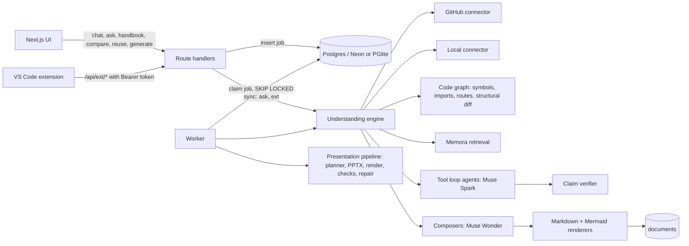

# GitFill architecture

A modular monolith: one Next.js app (UI + API), one worker process (or the same process with `INLINE_WORKER`), sharing `lib/`. A VS Code extension talks to the same API with personal tokens.

## Modules

| Path | Responsibility |
| --- | --- |
| `lib/connectors/` | Source connectors producing the connector-neutral `SourceSnapshot`. `github/` (URL parsing, allow-listed REST client with compare and commit listing, file selection, ingestion), `local.ts` (snapshot from files a client sends, same filters), `cache.ts` (in-memory snapshot cache for interactive use, revalidated by branch head). |
| `lib/analysis/` | Deterministic code analysis: `symbols.ts` (declarations with line ranges, 9 languages), `imports.ts` (import extraction and resolution), `graph.ts` (code graph, references, call graph by name, module graph, directory summary), `routes.ts` (HTTP routes for common frameworks), `structural-diff.ts` (symbols/dependencies/packages/routes/directories between two versions), `mermaid.ts` (structured diagram schema, normalization, safe Mermaid rendering, syntax check). |
| `lib/memora/` | The RAG pipeline integration: `client.ts` (Memora REST), `retriever.ts` (snapshot → Markdown bundles with path headings and line numbers → Memora subject; query → passages mapped to `path:lines`). |
| `lib/agent/` | The bounded tool loop, the shared repository tool box (`repo-tools.ts`: read/search/outline/find/call graph/routes/module graph/retrieve_context/record_claims over one or several repositories), the deck analyst and planner, the chat agent, and the recorder interface. |
| `lib/understanding/` | Feature agents and renderers: `schemas.ts` (Zod outputs: handbook, explanation, commit report, implementation brief, doc comments, docs drift), `handbook.ts`, `explain.ts`, `compare.ts`, `reuse.ts`, `docs.ts`, `render.ts` (footnoted evidence, GitHub links at the commit, diagram blocks). |
| `lib/evidence/` | Claim verification against real file lines. |
| `lib/jobs/` | Queue (Postgres `SKIP LOCKED`), pipeline dispatch by job kind, document jobs, inline worker, DB recorder and read models. |
| `lib/presentation/`, `lib/render/`, `lib/validation/`, `lib/documents/` | The presentation pipeline (deck spec, layout, PPTX, LibreOffice render, checks, repair, README and evidence report). |
| `lib/auth/` | Sessions (HMAC cookies), GitHub OAuth with per-user encrypted tokens (`github-token.ts`: AES-256-GCM at rest, `githubClientFor(user)` / `githubClientForJob(job)` so every GitHub read acts as the owner), API tokens (hashed) and request authentication for the extension API. |
| `lib/ext/` | Request schemas of `/api/ext/*`. |
| `extension/` | The VS Code extension (TypeScript, no bundler): commands, workspace collector, git helper, results webview, preview/apply flows. |

## Key decisions

- **One engine, many features.** Every feature is a prompt, a terminal tool schema and a renderer over the same snapshot, code graph, tool box and claim verifier. Adding a feature does not add a pipeline.
- **Code decides what is true.** The model proposes claims with file and line ranges; `verifyClaim` checks they exist and that backticked identifiers appear in the cited lines. Unknown refs are stripped from every structured output. Routes, symbols, dependency edges and structural diffs are computed, never asked of the model.
- **Diagrams are data.** Models emit nodes (with the file they represent) and edges; code renders Mermaid, escapes labels, removes dangling edges and marks inferred elements. Nothing a model writes is pasted into Mermaid.
- **Retrieval is delegated to Memora.** Snapshots are bundled so chunks map back to exact lines. Memora runs hybrid search, MMR and reranking; GitFill grounds and cites with Muse. When Memora is absent, literal search and the code graph take over, so features degrade rather than break.
- **Separate fact from inference everywhere.** Claims carry `verified`/`inferred`/`unverified`; diagram elements carry `inferred`; commit reports keep hypotheses in their own list; explanations list what could not be verified.
- **Bounded everything.** Agent turns, tool calls, claims, inline context, patch sizes, file sizes and index waits are all capped, and every failure is recorded as an event.
- **GitHub reads act as the user.** No shared crawler identity: imports, snapshots, commit listings and comparisons use the workspace owner's token, which gives per-user rate limits and private repository access, and makes "can this user read this repository" GitHub's decision. The snapshot cache re-resolves the branch head with the caller's token before serving a cached snapshot, so a private snapshot is never served across users.
- **Read-only by default.** The extension sends only relevant files, never writes without a preview and an explicit Apply, and applies changes as a single undoable `WorkspaceEdit`.
- **Simple jobs.** Postgres is the queue; PGlite mode runs the same pipeline in-process.

## Data model

`workspaces` → `workspace_repositories`; `projects` (one per job) → `repository_snapshots` (repo, branch, **commit SHA**, summary) → `evidence_claims`.
`generation_jobs` (kind: generate, revise, handbook, compare, reuse; status stages) → `agent_runs` → `agent_events`.
`documents` (kind, title, Markdown, structured spec, metadata, primary/secondary snapshot, job).
`decks` → `deck_versions` → `artifacts`. `api_tokens` (hashed) for the extension.

## Web-to-editor workflow (planned)

Implementation briefs are stored as validated JSON (`GET /api/documents/:id/download?format=json`). The next step is for the extension to fetch a brief, verify that the open workspace matches the target repository and commit, check that the files and interfaces in the plan still exist, and hand the plan to a coding workflow with the user's approval, then run the listed tests and show the diff.
